# DayZ Community Hub

[](https://git.thoxy.xyz/thoxy/dayz-community-hub/actions?workflow=ci.yml)
[](https://git.thoxy.xyz/thoxy/dayz-community-hub/releases)
-lightgrey?style=flat-square>)
[](LICENSE)

[](https://rust-lang.org/)
[](https://github.com/emilk/egui)
[](https://wgpu.rs/)
[](https://tokio.rs/)

A fast DayZ launcher that replaces the official one: browse every server, keep
your mods in order and join in one click, on Windows and Linux alike. A native
Rust application (egui on wgpu): no web view, one small executable, the full
server list scrolled smoothly.

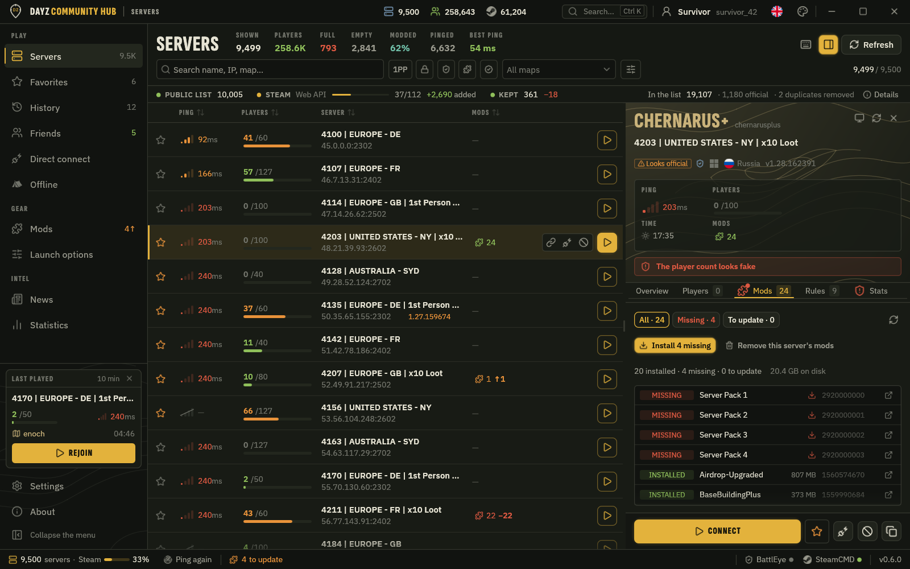

---

## Quick start

1. **Download** the [latest release](https://git.thoxy.xyz/thoxy/dayz-community-hub/releases) for your platform ([below](#download)).
2. **Run** it and follow the setup wizard: it finds Steam and DayZ for you.
3. **Play**: pick a server, press Connect, and the launcher installs what the server needs and starts the game.

New to it? The [user guide](docs/guide.md) walks through every view.

---

## Features

### Find a server

- **Every server, live.** The public list plus, with a free Steam Web API key, every server Steam's master lists (18,000+ together), pinged through one paced connection the way the official launcher does it.
- **Filters that matter.** Maps, first person, password, BattlEye, in-game day or night, a given mod, and *ready to join*: every mod installed and current, same game version as yours.
- **Server details.** Players, rules, mods with what you have or lack, and DayZ Metrics stats: rank, uptime, restarts, next wipe and a warning when the player count looks padded.
- **Favourites and history** with notes, coloured labels and groups, and a character name and launch arguments per favourite.
- **Friends** who play DayZ, on which server, with a button to join them.

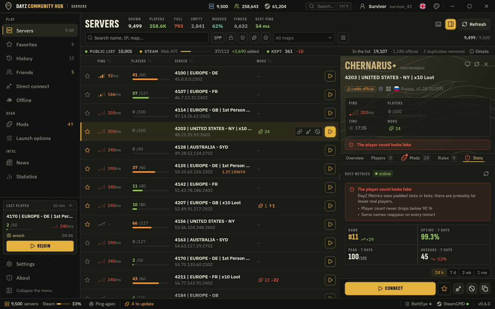

### Keep your mods in order

- **Installed on the way in.** A server's missing or stale mods download through SteamCMD or the Steam client before the game starts.
- **One view for all of them.** What is up to date, what waits for Steam, what no server you play uses any more, with updates, links and removals in bulk.
- **No copies.** Mods are linked into the game, not duplicated.

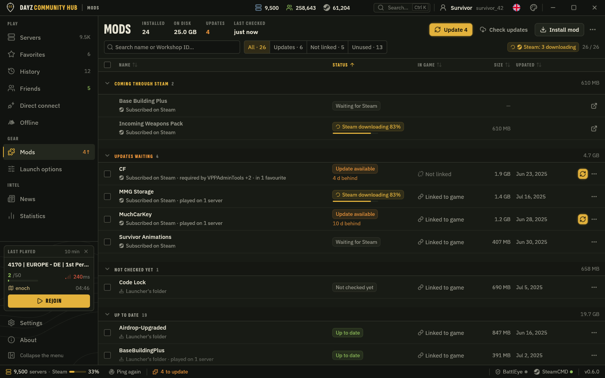

### Launch your way

- **One-click connect.** Starts Steam if needed, sets up the mods and joins; a desktop shortcut can do the same for a favourite.
- **Direct connect** to any address, and **launch options** for every DayZ start-up flag, tuned to your machine.
- **Offline mode.** Install and play [DayZ Community Offline Mode](https://github.com/Arkensor/DayZCommunityOfflineMode) missions locally, with the mods you pick.

<table>
  <tr>
    <td>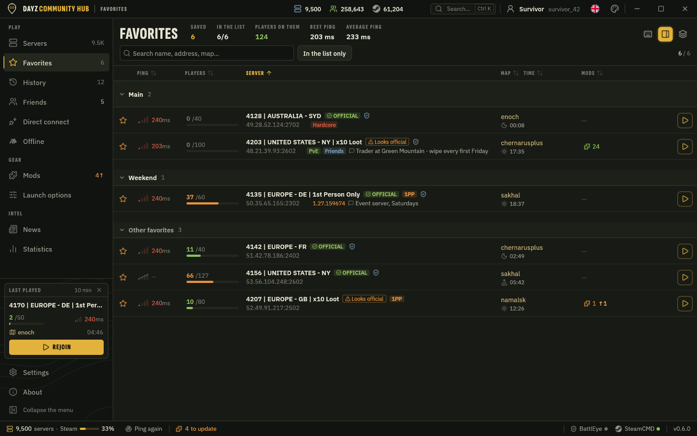</td>
    <td>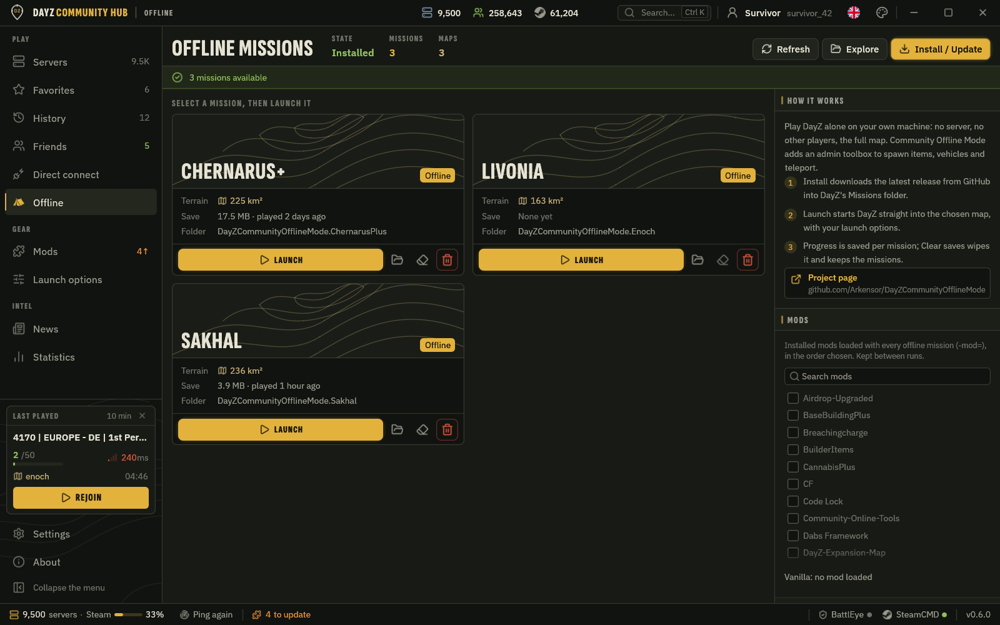</td>
  </tr>
  <tr>
    <td align="center"><sub>Favourites in groups, with notes and labels</sub></td>
    <td align="center"><sub>Offline missions on Chernarus+, Livonia and Sakhal</sub></td>
  </tr>
  <tr>
    <td>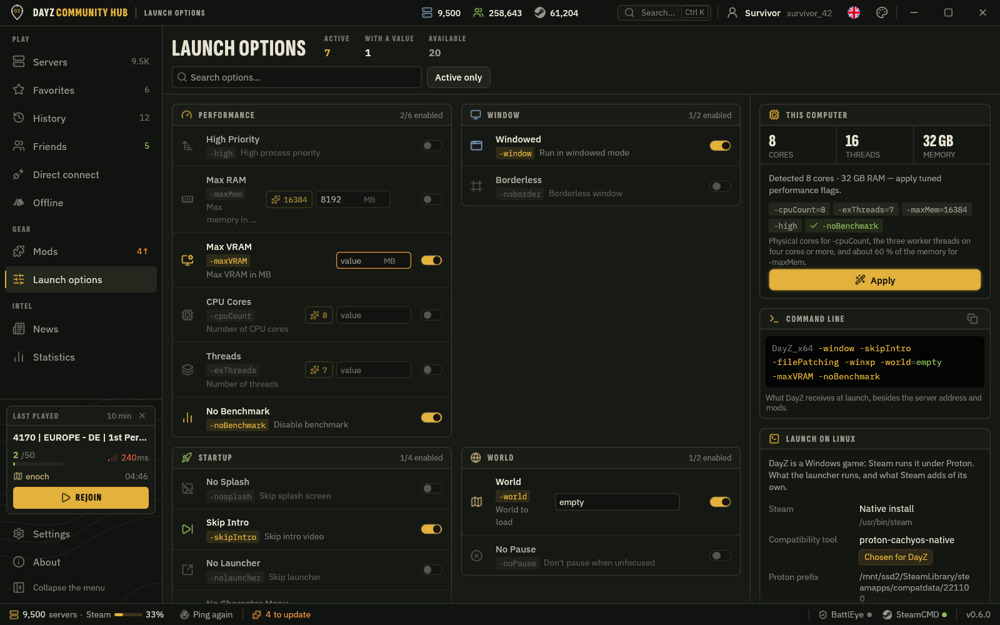</td>
    <td>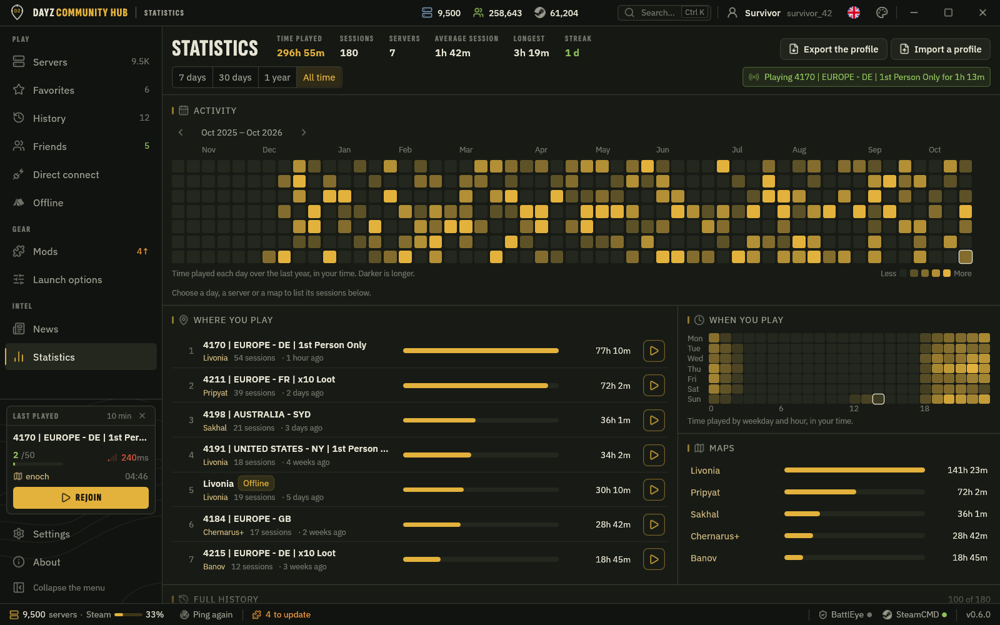</td>
  </tr>
  <tr>
    <td align="center"><sub>Launch options, with a suggestion for this computer</sub></td>
    <td align="center"><sub>Where and when you played, from your own sessions</sub></td>
  </tr>
  <tr>
    <td>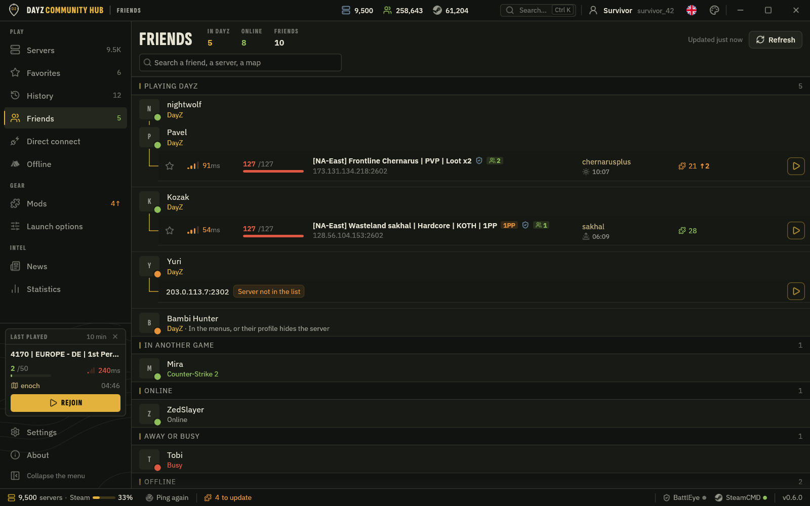</td>
    <td>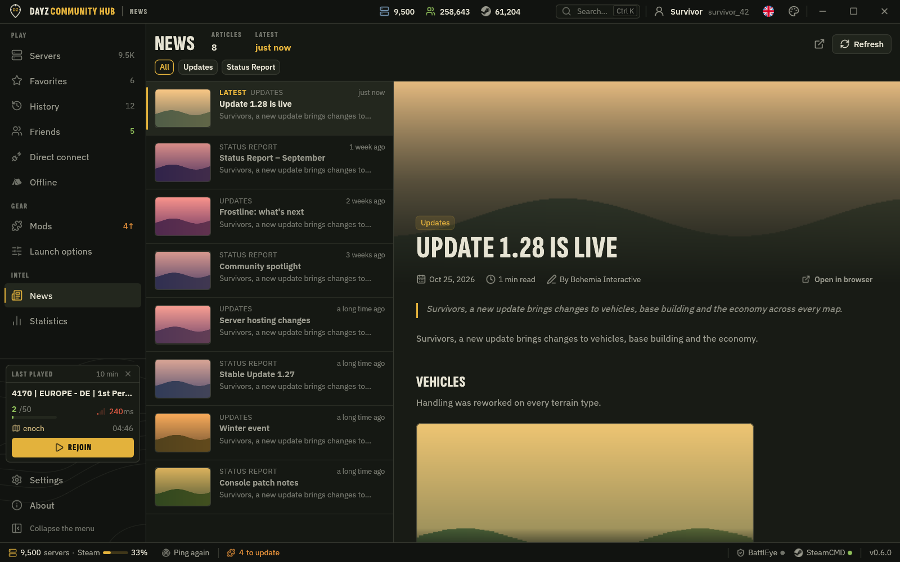</td>
  </tr>
  <tr>
    <td align="center"><sub>Friends and the servers they are on</sub></td>
    <td align="center"><sub>dayz.com's news and patch notes, in the launcher</sub></td>
  </tr>
</table>

### Keyboard, controller and Steam Deck

- **One set of shortcuts** and a **Ctrl+K palette** that runs any action by name.
- **A gamepad drives everything**: a focus ring, a hint bar with what each button does, bigger rows and text, an on-screen keyboard and a built-in file picker.
- **Steam Deck**: Deck button labels, Game Mode in full screen, and an *Add to Steam* button. See [the Steam Deck page](docs/steam-deck.md).

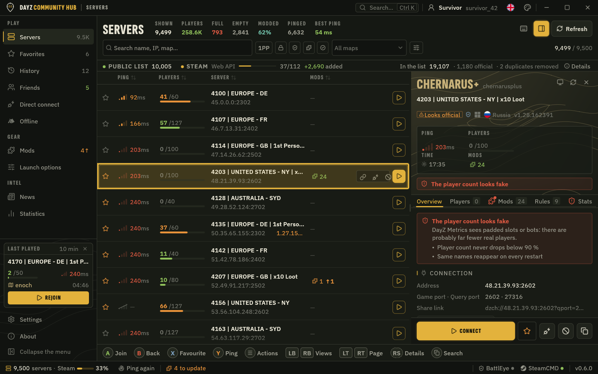

### Make it yours

- **Seventeen themes**, dark and light, that can follow the system, plus your own.
- **Seasonal themes** in October and December, with fog or falling snow, worn over yours without changing it (and easy to turn off).
- **Interface size** from 75 to 150 %, in five languages: English, French, German, Spanish and Russian.
- **Tray, notifications and Discord.** Keep the launcher in the tray, let it step aside while the game runs, hear when a download or an update is done, and show your game on Discord if you want to (off by default).

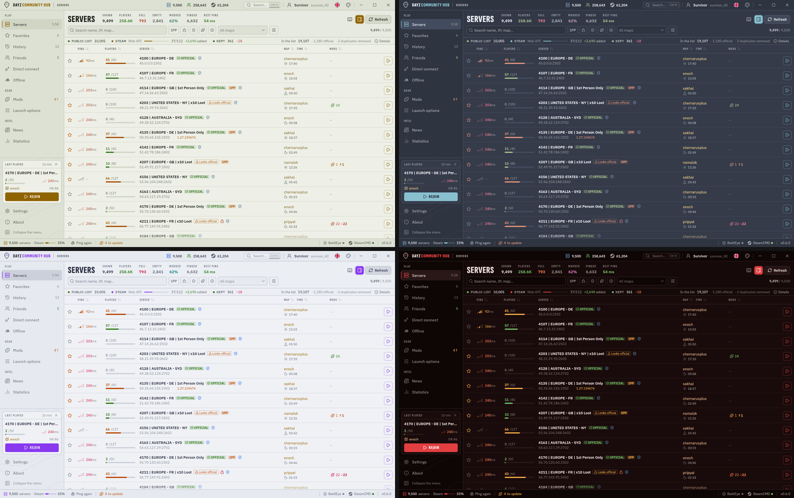

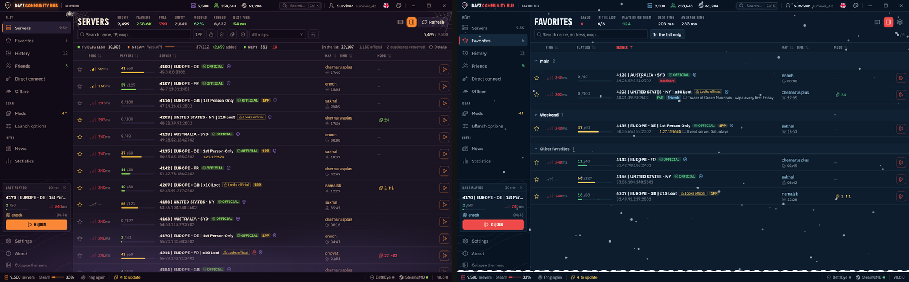

---

## Download

Go to [Releases](https://git.thoxy.xyz/thoxy/dayz-community-hub/releases) and grab the latest version. You need Steam and DayZ installed; Linux runs DayZ through Proton.

### Windows

Extract the `.zip` and run `dayz-community-hub.exe`. It updates itself: when a
new version is out, the launcher offers it and replaces itself in place.

### Linux (AppImage)

```bash
chmod +x dayz-community-hub-*.AppImage && ./dayz-community-hub-*.AppImage
```

The AppImage updates itself the same way. It needs nothing installed beyond
your graphics drivers, and runs on SteamOS as it is.

### Arch Linux (AUR)

The `dayz-community-hub-git` package builds the latest `master` from source:

```bash
git clone https://git.thoxy.xyz/AUR/dayz-community-hub-git.git
cd dayz-community-hub-git
makepkg -si
```

Rebuild to update (pacman owns this install, so the in-app updater stays out of it).

---

## Documentation

- [User guide](docs/guide.md): setup, finding servers, mods, launching, settings and troubleshooting
- [Steam Deck](docs/steam-deck.md): install, Game Mode and controls
- [All documentation](docs/README.md), including the developer pages
- [Changelog](CHANGELOG.md): what changed in each release

---

## Building from source

**Prerequisites:** Rust (rustup reads `rust-toolchain.toml`), uv, and on Linux
the headers of libudev and zstd (`libudev-dev libzstd-dev` on Debian/Ubuntu;
already there on Arch). No Node, no bun, no WebKit.

```bash
git clone https://git.thoxy.xyz/thoxy/dayz-community-hub
cd dayz-community-hub
make dev             # the app (make dev-mock: on an invented world)
make check           # everything a commit must pass
make build           # release executable (Linux, glibc 2.35 floor with zig)
make appimage        # the AppImage (Ubuntu 22.04 container, podman)
make windows         # Windows, cross-compiled with cargo-xwin
make screenshots     # every view, rendered headless on the invented world
```

`make` alone lists every target. Layout, releases (`make publish`), the glibc
floor and Windows cross-compilation are explained in [docs/build.md](docs/build.md).

---

## License

MIT, see [LICENSE](LICENSE). Third-party fonts and icons are credited in
[ATTRIBUTION.md](ATTRIBUTION.md).

DayZ is a trademark of Bohemia Interactive. This launcher is a community
project, not affiliated with or endorsed by Bohemia Interactive or Valve.
