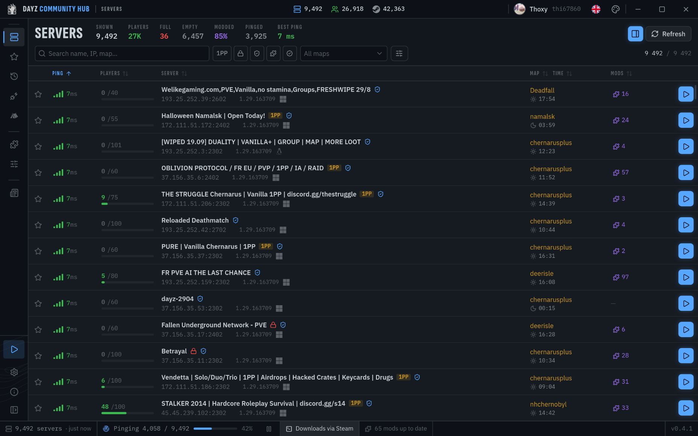

# DayZ Community Hub

[](https://git.thoxy.xyz/thoxy/dayz-community-hub/actions?workflow=ci.yml)
[](https://git.thoxy.xyz/thoxy/dayz-community-hub/releases)
-lightgrey?style=flat-square>)
[](LICENSE)

[](https://rust-lang.org/)
[](https://github.com/emilk/egui)
[](https://wgpu.rs/)
[](https://tokio.rs/)

A fast, feature-rich DayZ launcher that replaces the official one — browse servers, manage mods, and connect in one click. A native Rust application (egui on wgpu): no web view, one small executable.



---

## Quick Start

1. **Download** — grab the [latest release](https://git.thoxy.xyz/thoxy/dayz-community-hub/releases) for your platform
2. **Run** — extract and launch the app, complete the setup wizard
3. **Play** — find a server, hit Connect, and the app handles the rest

---

## Features

### Browse

- **18,000+ servers** — the public list plus the servers Steam's master lists, with live ping
- **Filter & search** — by map, mods, 1PP, password, BattleEye
- **Favorites & history** — star servers and track your sessions
- **Friends** — see which friends play DayZ, on which server, and join them
- **Server stats** — rank, uptime, restarts, wipes and player graphs from DayZ Metrics (no key)

### Mods

- **Auto-install** — missing mods download via SteamCMD or the Steam client before you connect
- **Update checker** — detect stale mods with one click
- **Bulk operations** — update, link, or delete multiple mods at once
- **Symlink management** — clean mod organization without duplicating files

### Launch

- **One-click connect** — starts Steam if needed, sets up mods, and joins
- **Direct connect** — join any server by IP:port
- **Launch options** — full control over DayZ startup flags
- **Offline mode** — play [DayZ Community Offline Mode](https://github.com/Arkensor/DayZCommunityOfflineMode) missions locally

### Extras

- **News feed** — latest DayZ articles in-app
- **Auto-updater** — Windows: updates apply in-place
- **Cross-platform** — runs on Windows and Linux
- **Keyboard, controller, Steam Deck** — one set of shortcuts, a Ctrl+K palette and a hint bar for the pad
- **Themes** — seventeen legible presets and your own, dark or light with the system

---

## Download

Go to [Releases](https://git.thoxy.xyz/thoxy/dayz-community-hub/releases) and grab the latest version.

### Windows

Extract the `.zip` and run `dayz-community-hub.exe`. It updates itself: when a
new version is out, the launcher offers it and replaces itself in place.

### Linux (AppImage)

```bash
chmod +x dayz-community-hub-*.AppImage && ./dayz-community-hub-*.AppImage
```

The AppImage updates itself the same way.

### Arch Linux (AUR)

The `dayz-community-hub-git` package builds the latest `master` from source:

```bash
git clone https://git.thoxy.xyz/AUR/dayz-community-hub-git.git
cd dayz-community-hub-git
makepkg -si
```

Rebuild to update (pacman owns this install, so the in-app updater stays out of it).

---

## Documentation

Full docs available in the [Wiki](https://git.thoxy.xyz/thoxy/dayz-community-hub/wiki) — setup, configuration, mod management, and more.

---

## Building from Source

**Prerequisites:** Rust (rustup reads `rust-toolchain.toml`), uv, and on Linux
the headers of libudev and zstd (`libudev-dev libzstd-dev` on Debian/Ubuntu;
already there on Arch). No Node, no bun, no WebKit.

```bash
git clone https://git.thoxy.xyz/thoxy/dayz-community-hub
cd dayz-community-hub
make dev             # the app (make dev-mock: on an invented world)
make check           # everything a commit must pass
make build           # release executable (Linux, glibc 2.35 floor with zig)
make appimage        # the AppImage (Ubuntu 22.04 container, podman)
make windows         # Windows, cross-compiled with cargo-xwin
```

`make` alone lists every target. Layout, releases (`make publish`), the glibc
floor and Windows cross-compilation are explained in [docs/build.md](docs/build.md).

---

## License

MIT — see [LICENSE](LICENSE)
